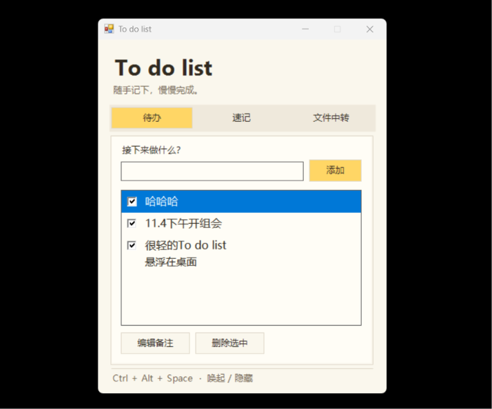
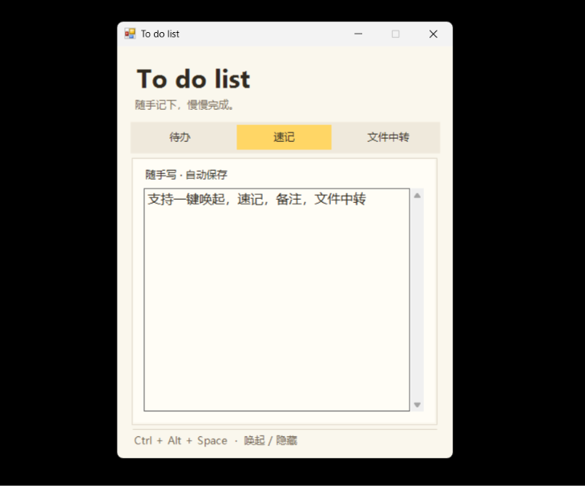
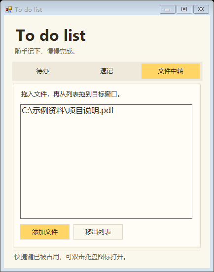

# To do list

随手记下，慢慢完成。一个轻量的 Windows 10 桌面待办工具，集待办、速记和文件中转于一处。

## 使用方法

下载并解压仓库，双击 `Start.cmd` 启动。使用系统自带的 Windows PowerShell，无需额外安装依赖。

- **随时唤起**：按 **Ctrl + Alt + 空格** 唤起或隐藏浮窗。关闭窗口会收进系统托盘，右键托盘图标可切换置顶或退出。
- **待办与备注**：输入后按回车添加，点击复选框标记完成。备注直接显示在对应待办下方。
- **速记**：直接输入，内容自动保存在本机。
- **文件中转**：把文件拖入列表，再拖到支持文件拖放的目标窗口。中转列表记录原文件路径，移出列表不会删除原文件。

待办、速记和中转列表保存在 `%LOCALAPPDATA%\LightTodo\data.json`。

## 界面预览

| 待办 | 速记 | 文件中转 |
| --- | --- | --- |
|  |  |  |
